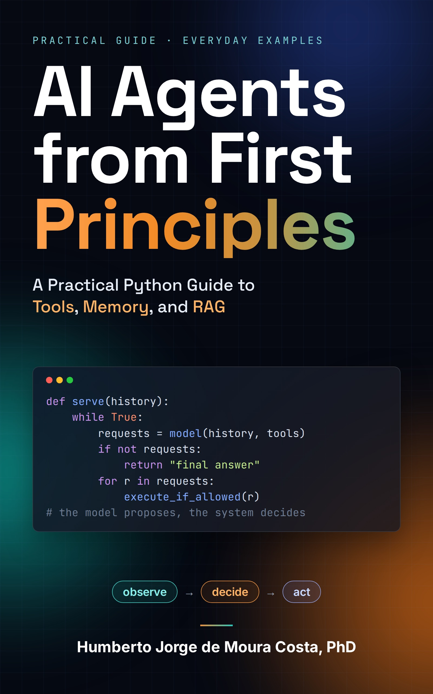

<div align="center">
  <a href="https://www.amazon.com.br/dp/B0HMZ3N4C4">
  
  </a>
</div>

# AI Agents from First Principles
**A Practical Python Guide to Tools, Memory, and RAG**


[](LICENSE)


> **Everyone talks about AI agents. This book shows you how to build one, step by step.**
>
> This repository holds the examples from *AI Agents from First Principles: A Practical Python Guide to Tools, Memory, and RAG*, by **Humberto Jorge de Moura Costa**. The goal is to understand and build the inner workings of an agent before relying on a framework's abstractions.


**Kindle edition:** 
[Amazon USA](https://www.amazon.com/dp/B0HNJ65Q5S) 

Other stores: [UK](https://www.amazon.co.uk/dp/B0HNJ65Q5S) [DE](https://www.amazon.de/dp/B0HNJ65Q5S) [FR](https://www.amazon.fr/dp/B0HNJ65Q5S) [ES](https://www.amazon.es/dp/B0HNJ65Q5S) [IT](https://www.amazon.it/dp/B0HNJ65Q5S) [NL](https://www.amazon.nl/dp/B0HNJ65Q5S) [JP](https://www.amazon.jp/dp/B0HNJ65Q5S) [BR](https://www.amazon.com.br/dp/B0HNJ65Q5S) [CA](https://www.amazon.ca/dp/B0HNJ65Q5S) [MX](https://www.amazon.com.mx/dp/B0HNJ65Q5S) [AU](https://www.amazon.com.au/dp/B0HNJ65Q5S)


**Paperback edition:** 
[Amazon USA](https://www.amazon.com/dp/B0HNJGRL9S) 

Other stores: 
[UK](https://www.amazon.co.uk/dp/B0HNJGRL9S) [DE](https://www.amazon.de/dp/B0HNJGRL9S) [FR](https://www.amazon.fr/dp/B0HNJGRL9S) [ES](https://www.amazon.es/dp/B0HNJGRL9S) [IT](https://www.amazon.it/dp/B0HNJGRL9S) [NL](https://www.amazon.nl/dp/B0HNJGRL9S) [JP](https://www.amazon.jp/dp/B0HNJGRL9S) [CA](https://www.amazon.ca/dp/B0HNJGRL9S) [AU](https://www.amazon.com.au/dp/B0HNJGRL9S)
 

The book covers the fundamentals and the step-by-step construction of AI agents in Python. This repository provides the hands-on examples and the automated tests.

The thread running through the book is **Rosa's Bakery**, a teaching scenario that grows from simple decisions into tools, human approval, memory, and document lookup.

**What to expect:**

- **Five progressive, independent examples**, matching the book's hands-on chapters.
- **Python code**, with expected outputs and automated tests.
- **No API key needed** to run the five teaching examples. One extra demo in Chapter 15 uses the OpenAI API.
- **Focus on fundamentals:** the examples illustrate the parts of an agent, not a production-ready system.

## Examples by chapter

| Part | Chapter | What you'll explore | Folder |
|---|---:|---|---|
| **1 · Foundations** | 8 | A rule-based reflex agent with observation and internal state, no LLM | [`part1_ch08_thermostat`](examples/part1_ch08_thermostat) |
| **2 · The Agent Loop** | 15 | Tool calling, loop control, and simulated versus real LLM use | [`part2_ch15_assistant`](examples/part2_ch15_assistant) |
| **3 · The Agent's Tools** | 24 | Validation, human approval, resuming, and preventing duplicate actions | [`part3_ch24_tools`](examples/part3_ch24_tools) |
| **4 · The Workbench and the Notebook** | 33 | Selecting, updating, expiring, access-controlling, and compacting memory | [`part4_ch33_notebook`](examples/part4_ch33_notebook) |
| **5 · Look It Up Before You Answer** | 42 | Teaching-scale document search, access filters, citations, and "couldn't find it" | [`part5_ch42_folder`](examples/part5_ch42_folder) |

Each folder has an `expected_output.txt` file. The tests check that the five local demos print exactly what's recorded there.

## Start here

You need **Python 3.11 or newer** and, to clone the repository, Git. The appendix, *Set Up Your Environment*, at the end of the book walks through the setup step by step.

```bash
git clone https://github.com/humbertomoura/ai-agents-from-first-principles.git
cd ai-agents-from-first-principles
python -m venv .venv
source .venv/bin/activate        # Windows (PowerShell): .venv\Scripts\Activate.ps1
python -m pip install -r requirements-dev.txt
python -m pytest -q
```

Then run any example from its folder, starting at the repository root:

```bash
cd examples/part1_ch08_thermostat
python run.py
cd ../..                         # back to the repository root
```

The entry script is `run.py` (Chapter 8), `simulated.py` (Chapter 15), or `story.py` (Chapters 24, 33, and 42). `tests/test_contracts.py` checks the contracts the chapters promise: validation before action, terminal states, approval bound to the exact proposal, idempotent retries, memory updates, and the role of retrieved data.

## The Chapter 15 demo with a real model

Only `real.py`, in `part2_ch15_assistant`, calls a real model. Store your key in an environment variable, never in the code. From the repository root:

```bash
export OPENAI_API_KEY="your-key"
export OPENAI_MODEL="gpt-6-astra"   # check the documentation for the recommended model
cd examples/part2_ch15_assistant
python real.py
```

API use is billed. Before running it, set a low spending alert **and**, where available, a hard spend limit for the project: an alert alone does not stop requests.

## Edition and versions

The code that matches the first edition of the book is tagged `v1.0-book`. Later changes on `main` may differ from the printed listings. The examples were tested with Python 3.11 to 3.13 (see the CI workflow) and `openai` 3.35.1.

## What the examples are (and aren't)

Each example is an independent teaching demonstration of one building block. They deliberately simplify: for instance, the Chapter 24 intention key treats "same customer, product, and day" as one order, and the Chapter 42 check only confirms that cited labels exist, not that the answer is supported. Each chapter explains its own limits under "What's missing for production."

## Contact

Questions or suggestions: [book@humbertomoura.com.br](mailto:book@humbertomoura.com.br).

## License

MIT. See [LICENSE](LICENSE).
